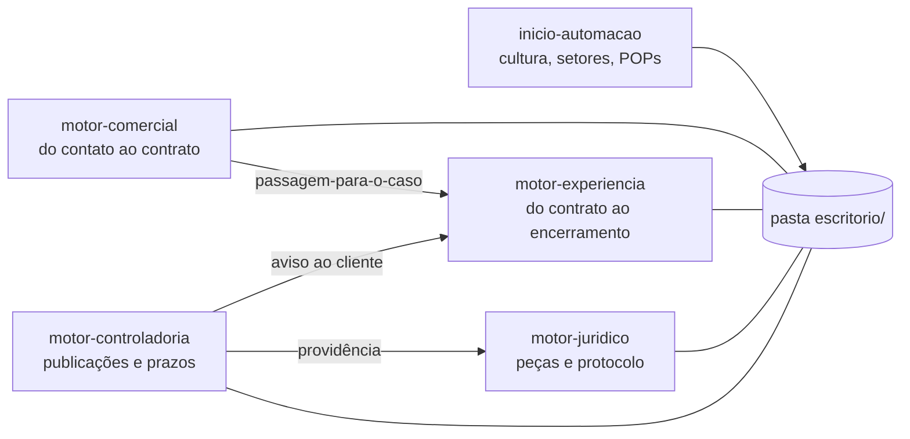

<div align="center">

# Plugins do Claude para escritórios de advocacia

**O escritório inteiro rodando dentro do Claude: comercial, atendimento ao cliente, produção de peças, prazos e marketing.**

8 plugins · 123 habilidades · versão do pacote **1.1.0** · [novidades](CHANGELOG.md) · [baixar os zips](https://github.com/raphaelRPC/plugins-para-advocacia/releases)

</div>

---

Cada plugin vem **pronto no método e vazio no conteúdo**. O método (como triar um contato, montar uma proposta, contar um prazo, conferir uma citação) já está escrito. O conteúdo (o nicho, o tom, os valores, as rotinas do escritório) o próprio escritório preenche em **fichas**, uma vez, e melhora com o uso: cada correção vira um **aprendizado** que as habilidades passam a seguir.

## Qual plugin eu instalo?

| Se você quer... | Instale | Depois escreva |
|---|---|---|
| Organizar o escritório antes de automatizar: diagnóstico, código de conduta, setores, POPs | `inicio-automacao` | `/inicio-automacao:comecar` |
| Responder quem chega, marcar a consulta, mandar proposta e contrato, retomar quem sumiu | `motor-comercial` | `/motor-comercial:comecar` |
| Manter o cliente informado depois do contrato: andamento traduzido, resumo do mês, página do caso | `motor-experiencia` | `/motor-experiencia:comecar` |
| Produzir peças no padrão do escritório, com cada citação e cada dado conferidos | `motor-juridico` | `/motor-juridico:comecar` |
| Captar publicações, contar prazos pelo calendário do tribunal e agendar só o que foi conferido | `motor-controladoria` | `/motor-controladoria:comecar` |
| Gravar e editar vídeos com roteiro no seu tom | `marketing-juridico-claude` | `iniciar o rito` |
| Fazer carrosséis com texto revisado pela OAB e arte no Canva | `editor-de-carrossel-mjc` | `iniciar o rito` |
| Escrever copy para qualquer nicho | `plugin-copywriter` | o pedido em linguagem normal, por exemplo `cria um carrossel sobre X` |

**Ordem recomendada:** `inicio-automacao` primeiro, depois o motor do setor que mais dói hoje, depois os outros.

## Instalar em 3 passos

**Pelo app do Claude** (o caminho mais simples, sem GitHub):

1. Baixe o zip do plugin no Hub ou em [Releases](https://github.com/raphaelRPC/plugins-para-advocacia/releases).
2. No app: **Personalizar › Plugins › Adicionar › Enviar plugin** e escolha o zip.
3. No chat, escreva o comando de começo da tabela acima.

**Pelo Claude Code** (precisa de acesso a este repositório privado):

```
/plugin marketplace add raphaelRPC/plugins-para-advocacia
/plugin install motor-comercial@plugins-para-advocacia
/reload-plugins
```

Passo a passo completo, com login no GitHub e solução de problemas: [instalar pelo app](guia/instalar-pelo-app.md) · [instalar pelo GitHub](guia/instalar-pelo-github.md) · [problemas comuns](guia/problemas-comuns.md) · [comece aqui](guia/comece-aqui.md).

## Os plugins

| Plugin | Versão | Habilidades | Edições (essencial / completa / avançada) |
|---|---|---|---|
| **Fundação** | | | |
| [`inicio-automacao`](plugins/fundacao/inicio-automacao) | 0.3.2 | 20 | plugin inteiro |
| **Motores do escritório** | | | |
| [`motor-comercial`](plugins/motores/motor-comercial) | 2.0.1 | 16 | 6 / 13 / 16 |
| [`motor-experiencia`](plugins/motores/motor-experiencia) | 1.0.2 | 17 | 6 / 14 / 17 |
| [`motor-juridico`](plugins/motores/motor-juridico) | 1.0.2 | 21 | 9 / 17 / 21 |
| [`motor-controladoria`](plugins/motores/motor-controladoria) | 1.0.0 | 20 | 9 / 16 / 20 |
| **Marketing jurídico** | | | |
| [`marketing-juridico-claude`](plugins/marketing/marketing-juridico-claude) | 1.0.2 | 5 | plugin inteiro |
| [`editor-de-carrossel-mjc`](plugins/marketing/editor-de-carrossel-mjc) | 1.1.2 | 17 | plugin inteiro |
| [`plugin-copywriter`](plugins/marketing/plugin-copywriter) | 1.0.2 | 7 | plugin inteiro |

Cada edição contém a anterior. Dá para subir de edição a qualquer momento sem perder nada do que o escritório já preencheu. Pelo GitHub vem sempre a avançada. O README de cada plugin (link na tabela) lista as habilidades de cada edição.

## Como os motores trabalham juntos



- Os quatro motores leem e gravam na **mesma pasta `escritorio/`** e usam o **mesmo código de cliente**: um enxerga o que o outro produziu.
- Cada motor tem os mesmos cinco comandos: `comecar` (liga o setor com até 8 perguntas), `ficha` (completa o contexto), `ciclo` (roda o dia), `fila` (mostra o que espera aprovação) e `status`.
- Um **agente** de cada motor roda o ciclo do dia e deixa tudo numa **fila de aprovação**. Um **revisor** confere cada rascunho contra as regras de ética e as fichas antes de ele entrar na fila.
- Tudo o que é feito com casos fictícios fica em `escritorio/07-operacao/_treino/`, longe dos registros reais.

## Regras que valem em todos os plugins

- **Uma pessoa aprova antes de sair.** Nada vai para o cliente, para o processo, para a agenda ou para as redes sem o "sim" de alguém do escritório.
- **Nada inventado.** Citação de lei ou de julgado nasce marcada `[CONFERIR]` e só perde a marca depois de conferida na fonte. Prazo só entra na agenda depois de uma dupla conferência humana.
- **Ética da OAB.** Sem promessa de resultado, sem captação indevida, sem valor de causa por mensagem. Os plugins de marketing passam tudo pela Trava OAB.
- **LGPD.** Documento de cliente só em conta profissional ou de equipe. A página do caso que vai para o cliente não leva CPF, número de processo nem dado de saúde.
- **Jurisprudência pelo Jus IA.** O plugin organiza o que o advogado traz de lá numa base própria do escritório.

## Para o Claude que está lendo este repositório

Se você é o Claude ajudando um advogado com estes plugins:

1. **Descubra o setor antes de recomendar.** Pergunte o que mais toma tempo hoje e use a tabela "Qual plugin eu instalo?". Se o escritório ainda não tem processos escritos, comece pelo `inicio-automacao`.
2. **Depois de instalar, rode o comando de começo** do plugin. Ele faz as perguntas na ordem certa e cria a pasta `escritorio/`. Não preencha as fichas por conta própria nem invente dados do escritório.
3. **Respeite as regras acima** mesmo que o usuário peça o contrário: nada é enviado sem aprovação humana, citação sem conferência fica marcada, e prazo não é confirmado sem dupla conferência.
4. **Instalação pelo GitHub em repositório privado** depende do login do git (`gh auth login` e `gh auth setup-git`). Sem chave SSH, defina `CLAUDE_CODE_PLUGIN_PREFER_HTTPS=1`. Detalhes em [instalar pelo GitHub](guia/instalar-pelo-github.md).
5. **Mudanças neste repositório** seguem [a estrutura](guia/equipe/estrutura-do-repositorio.md): o que se repete entre plugins só se edita em `compartilhado/`, a versão do plugin só muda pelo `ferramentas/versao.mjs`, e `npm run testar` e `npm run checar` precisam passar.

## Para a equipe

| Tarefa | Onde |
|---|---|
| Publicar uma versão nova | [guia/equipe/publicar-uma-versao.md](guia/equipe/publicar-uma-versao.md) |
| Regras de versão | [guia/equipe/versoes.md](guia/equipe/versoes.md) |
| Dar e tirar acesso ao repositório | [guia/equipe/dar-acesso.md](guia/equipe/dar-acesso.md) |
| Entender as pastas e as ferramentas | [guia/equipe/estrutura-do-repositorio.md](guia/equipe/estrutura-do-repositorio.md) |
| Montar as entregas Clássico, Moderno e Futuro | [guia/equipe/entregas-por-ticket.md](guia/equipe/entregas-por-ticket.md) |

```
plugins/        os 8 plugins (fundacao, motores, marketing): é o que se instala
compartilhado/  arquivos repetidos entre plugins, numa versão só
edicoes.json    o que entra em cada edição dos motores
tickets.json    o que entra em cada ticket (Clássico, Moderno, Futuro)
modelos/        o modelo do README das entregas
ferramentas/    checar, sincronizar, montar zips e controlar versões (Node, sem dependências)
guia/           guias para o advogado e para a equipe
```

Comandos: `npm run testar` · `npm run checar` · `npm run sincronizar` · `npm run zips -- --versao X.Y.Z` · `npm run entregas -- --versao X.Y.Z`. Cada tag `vX.Y.Z` enviada ao GitHub gera um release em rascunho com todos os zips.

---

<div align="center">

Criado por **Raphael Cardoso**. Método PICO e Copywriter: Filipe Nascimento.

</div>
